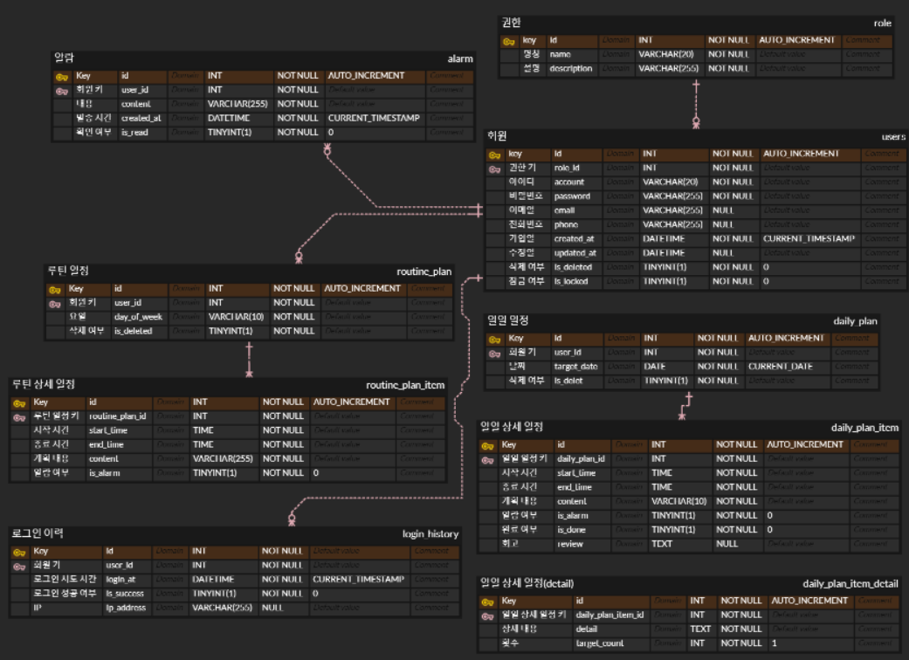

# ERD 설계
[물리적 모델링(ERD)(https://www.erdcloud.com/d/hgrwuFWWPKn24Xn8S)]

## 주요 테이블 설명

테이블명 | 영문 명 | 설명
| :--- | :--- | :--- |
| 회원 | users | 서비스 이용자 정보 관리 |
| 권한 | role | 서비스 이용자가 가질 수 있는 권한 (인가에 사용) |
| 알람 | alarm | 서비스에게 보낸 알람 |
| 루틴 일정 | routine plan | 반복 일정 템플릿으로 요일마다 한 개씩 설정 가능 |
| 루틴 상세 일정 | routine plan item | 루팅 일정의 상세한 내용 |
| 일일 일정 | daily plan | 실제 실행할 계획 |
| 일일 상세 일정 | daily plan item | 일정의 내용 |
| 일일 상세 일정(detail) | daily plan item detail | 계획의 정확한 횟수 등을 표시(운동 -> 팔굽혀펴기 20회 등) |
| 로그인 이력 | login history | 로그인 시도마다 기록 |
